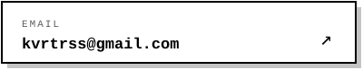
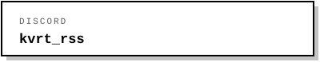

<!-- ========== Header ========== -->

  

 

## About

I'm no expert, and I don't claim to know everything. I'm just someone who enjoys learning new things, putting that knowledge into practice, and seeing what I can make along the way. Every project is a chance to learn something new, make mistakes, and do a little better than before.

## Currently Learning

## Activity

<table>
  <tr>
    <td width="50%"></td>
    <td width="50%"></td>
  </tr>
</table>

## Contact

<table>
  <tr>
    <td width="50%"></td>
    <td width="50%"></td>
  </tr>
</table>

<!-- ========== Footer ========== -->

  Always building. Always learning. Trying to do better.

